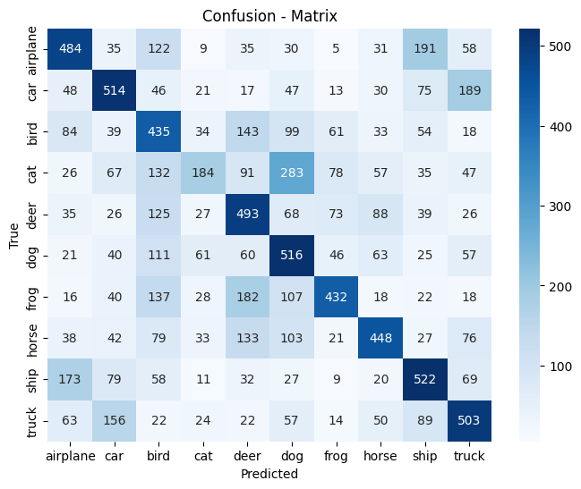
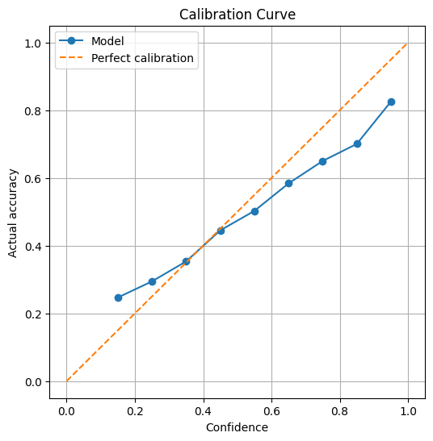

# Calibration — the model that knows what it doesn't know

A CIFAR-10 image classifier that does not guess when it is unsure.
When confidence is below a threshold, it sends the picture to a human
for review instead of making a confident wrong guess. Human labels are
saved for a future batch retrain.

## Model

- Dataset: CIFAR-10 — 50,000 train / 10,000 test, 32×32, 10 classes
  (airplane, car, bird, cat, deer, dog, frog, horse, ship, truck)
- Base model: ResNet18, pretrained on ImageNet, backbone frozen
- New head: Linear(512, 10) — 5,130 trainable parameters, head-only training
- Training: 3 epochs, batch 64, CrossEntropyLoss, Adam (lr 0.001)
- Run in Google Colab on a Tesla T4 GPU, Nov 5, 2026

## Results — final run, Nov 5, 2026

Overall test accuracy: **45.31% (4531 / 10000)**

Per-class accuracy (correct / 1000):
- airplane 484 (48.4%), car 514 (51.4%), bird 435 (43.5%)
- cat 184 (18.4%), deer 493 (49.3%), dog 516 (51.6%)
- frog 432 (43.2%), horse 448 (44.8%), ship 522 (52.2%), truck 503 (50.3%)

Confusion matrix: the diagonal matches the counts above.
Biggest confusions are look-alike pairs — cat predicted as dog 283 times,
airplane as ship 191, ship as airplane 173, truck as car 156.

## Calibration

Confidence = max softmax probability. Threshold chosen from the data: **0.50**

| Threshold | Auto-decided | Sent to review | Accuracy on auto-decided |
|-----------|--------------|----------------|--------------------------|
| 0.30 | 7739 | 2261 | 50.19% |
| 0.40 | 5603 | 4397 | 55.85% |
| 0.50 | 3833 | 6167 | 61.07% |
| 0.60 | 2538 | 7462 | 66.59% |
| 0.70 | 1632 | 8368 | 71.14% |
| 0.80 | 926 | 9074 | 75.81% |
| 0.90 | 425 | 9575 | 82.59% |

At 0.50, the model auto-decides 3,833 pictures at 61.07% accuracy and
sends 6,167 to human review. Higher thresholds are more accurate on the
auto-decided set, but send more work to a human.

Calibration curve: accuracy rises steadily with confidence, close to the
perfect-calibration line. Slightly overconfident at the top
(0.9–1.0 confidence, 82.6% actually right) and slightly underconfident
at the bottom (0.1–0.2 confidence, 24.7% actually right).

## Human review

Unsure pictures (confidence < 0.50) go to a human review queue with
their top 3 guesses. The human gives a label, not a confidence number.
Labels are saved in `human_review_labels.json` (6,167 entries at 0.50)
for a future batch retrain. The model replies:
"got it, thank for review, i am still learning"

Important: these labels are for retraining on new pictures later.
The model was NOT retrained on the test set, and the test set was
NOT used to re-grade after review.

## Files

- `calibration.ipynb` — full notebook: data, model, training, grading,
  confusion matrix, calibration, human review
- `cifar_resnet18_head.pth` — saved head weights (42.7 MB)
- `human_review_labels.json` — human labels for unsure pictures
- `confusion_matrix.png` — confusion matrix heatmap
- `calibration_curve.png` — calibration curve chart

## How to run

1. Open `calibration.ipynb` in Colab with a GPU runtime.
2. Run the cells top to bottom, in order.
3. After training, save the weights and download the `.pth` file
   right away — a dead Colab session loses the trained model.

## Limitations

- CIFAR-10 has only 10 classes. A picture outside those 10 is
  force-guessed into one of them — there is no out-of-distribution check yet.
- Head-only training: the frozen backbone never learns CIFAR-specific
  features. Unfreezing the last layers is a possible v2.
- Overall accuracy is modest (45.31%). The point of this project is
  not a high score — it is knowing when not to guess.

## Next steps

- Unfreeze the last ResNet blocks and retrain (v2)
- Add an out-of-distribution check for non-CIFAR uploads
- Batch-retrain on collected human-labelled hard cases and measure
  improvement on similar new pictures, not on the test set
